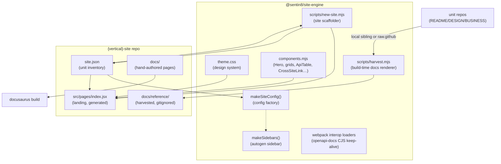

# Sentin8:Site-Engine - Shared Website Engine

> The shared Docusaurus engine behind `sentin8.dev` and every
> `{vertical}.dev` site. Design of record:
> `design/sentin8-websites-design.md` (WEB); per `documents.md` this file is
> the overview, `DESIGN.md` the wire-level detail, `BUSINESS.md` the
> business view.

## 1. Summary

`@sentin8/site-engine` is one npm package that turns a declarative
`site.json` unit inventory into a complete public website: the
Docusaurus config + sidebar factories, the Sentin8 design system
(Inter, glass panels, 4px grid, dark-first, WCAG AA), the
MDX-importable component set (landing hero, service/product/app/SDK
grids, security pillars, API tables, cross-site links), the
build-time docs harvester (renders each unit repo's
`README.md`/`DESIGN.md`/`BUSINESS.md` into the site's reference
section), and the `new-site.mjs` scaffolder that generates a new
vertical site in one command.

## 2. Motivation

Seven websites must share one design language, one component set, and
one build/deploy story without becoming one repo: each vertical org
owns its own site repo (per-org topology, WEB §3), and vertical content
PRs must not touch the platform. A single engine package consumed as a
pinned git dependency gives every site identical theming and mechanics
with zero code duplication - the same discipline the Rust SDK ring uses
(`sdk-vX.Y.Z` pins), applied to npm.

## 3. Architecture & High-Level Design



**One engine, seven sites.** Each `{vertical}-site` repo holds only its
`site.json`, hand-authored content pages, and the generated landing -
everything mechanical comes from this package.

## 4. Key Traits and Data Structures

- **`site.json` contract** - the per-site inventory: `vertical`, `name`,
  `org`, `domain`, `tagline`, `accent`, `pillars`, `units[]`,
  `apps[]`, `sdks[]`, `showcase[]`, `crossrefs[]`. Units carry `slug`,
  `kind` (`service`|`starter`|`app`|`sdk`), `name`, `repo`, `org`,
  `summary`, `scopes` (the OAuth scope vocabulary shown on cards).
- **`makeSiteConfig(site)`** - emits the entire Docusaurus config:
  Mermaid theme, dark-first color mode, navbar (Products/Services +
  Apps dropdowns, Security, Developers, Samples, the
  `{vertical}.dev` family dropdown, GitHub), footer with all eight
  family links, custom fields carrying `site` + `accent` + `domain`
  for landing pages, and the interactive OpenAPI layer:
  `docusaurus-plugin-openapi-docs` (+ theme) fed by the per-unit
  `openapi/config.json` sidecar the harvester writes, plus the
  webpack interop loaders that keep the plugin/theme CJS libs
  browser-safe and `docItemComponent: '@theme/ApiItem'` so API
  pages hydrate the openapi theme's store-backed explorer.
- **`makeSidebars()`** - a fully autogenerated docs sidebar; section
  order is owned by `_category_.json` files the scaffolder emits.
- **JSX-free components** - every component is authored with plain
  `createElement` (internal `h()`), because Docusaurus excludes
  `node_modules` from its Babel/MDX pipeline: engine components must
  not require transpilation. Site-local pages use MDX freely.
- **`harvest.mjs`** - for every service/starter/app/sdk unit: resolve
  `README.md`/`DESIGN.md`/`BUSINESS.md`/`SECURITY.md`/`CHANGELOG.md`
  from the local sibling folder first (offline dev), then
  `raw.githubusercontent.com/{org}/{repo}/main/`; emit under
  `docs/reference/{slug}/` with `format: md` frontmatter (raw
  maintainer HTML can't break MDX) and provenance frontmatter. Missing
  remote files are skipped; fetch failures fail the build - docs never
  silently trail.
- **`new-site.mjs`** - scaffolds a new site repo: `package.json` (with
  the engine pinned by git tag, or `--local` sibling path), config,
  sidebars, CSS, the data-driven landing page, docs category skeleton
  (`security/`, `products|services/`, `apps/`, `sdk/`, `developers/`,
  `samples/`, `reference/`), `CNAME`, `.gitignore`, and the site.json
  copy.

## 5. Rationale, Trade-offs, and Alternatives

- **Docusaurus v3 over Starlight/Next.js/SaaS** - decided at the design
  level (WEB §2): built-in Mermaid (334 diagrams across the tree's
  docs), doc versioning for SDK-tagged docs, MDX components, and a
  real docs engine under a custom landing - see the design doc's full
  comparison table.
- **JSX-free engine components** - transpilation-in-node_modules is
  unsupported by Docusaurus; authoring with `h()` removes the entire
  class of "component fails to render inside node_modules" defects at
  the cost of terser code. Site pages (not shipped in node_modules)
  keep JSX.
- **Harvested pages are `format: md`** - maintainer docs contain raw
  HTML and angle brackets; MDX would reject them. Mermaid blocks still
  render through the theme; the trade-off is no MDX components *inside*
  harvested pages (they stay pure maintainer truth).
- **Local-sibling-first resolution** - makes the aggregation tree the
  offline source of truth; the remote fallback is what CI uses, so the
  public sites render exactly what the public repos show.
- **Rejected: a central sites monorepo** - one repo would mean
  vertical content PRs land in the Sentin8 org, breaking the per-org
  ownership topology (WEB §3); the engine package achieves sharing
  without the coupling.

## 6. Internal Implementation & Invariants

- The harvester **never writes outside `docs/reference/`** and wipes it
  on every run - harvested output is a build artifact, never
  hand-edited (gitignored by the scaffolder).
- `_category_.json` position counters start at 100 so hand-authored
  sections sort before reference subtrees.
- `site.json` is the ONLY per-site data source; components never
  hardcode a unit list (a new unit is a data edit, never an engine
  change).
- Engine components accept `items` arrays, never import site.json
  themselves - landing pages do the mapping, keeping the components
  reusable across all seven sites.

## 7. Development

```bash
npm test                 # node:test suite (config/sidebar factories)
```

Local end-to-end: scaffold a site against the sibling engine
(`--local`), then `npm install && npm start` inside the site repo (see
the design doc's §4 workflows). Ship a release with
`git tag site-engine-vX.Y.Z` - sites pin the tag
(`git+https://github.com/Sentin8/sentin8-site-engine.git#site-engine-vX.Y.Z`),
the same ring discipline as the SDK's `sdk-vX.Y.Z` pins.

## 8. Unresolved Questions / Future Designs

- The interactive OpenAPI reference (`docusaurus-plugin-openapi-docs`
  + theme, wired through `makeSiteConfig` with the scoped webpack
  interop loaders and `docItemComponent: '@theme/ApiItem'`) is live; a
  DESIGN.md for the engine's internals (harvest pipeline, loader
  mechanics, sidebar merge) remains open when engine internals need a
  wire-level record.
- Doc versioning for SDK-tagged pages (Docusaurus native) once a
  second SDK tag needs documenting.
- Component i18n (OQ-3) - deferred until markets demand it.

---

**Design attribution:** Sentin8:Site-Engine and its underlying concepts were designed by Hamid Jahanzad <Hamid@Jahanzad.com>.